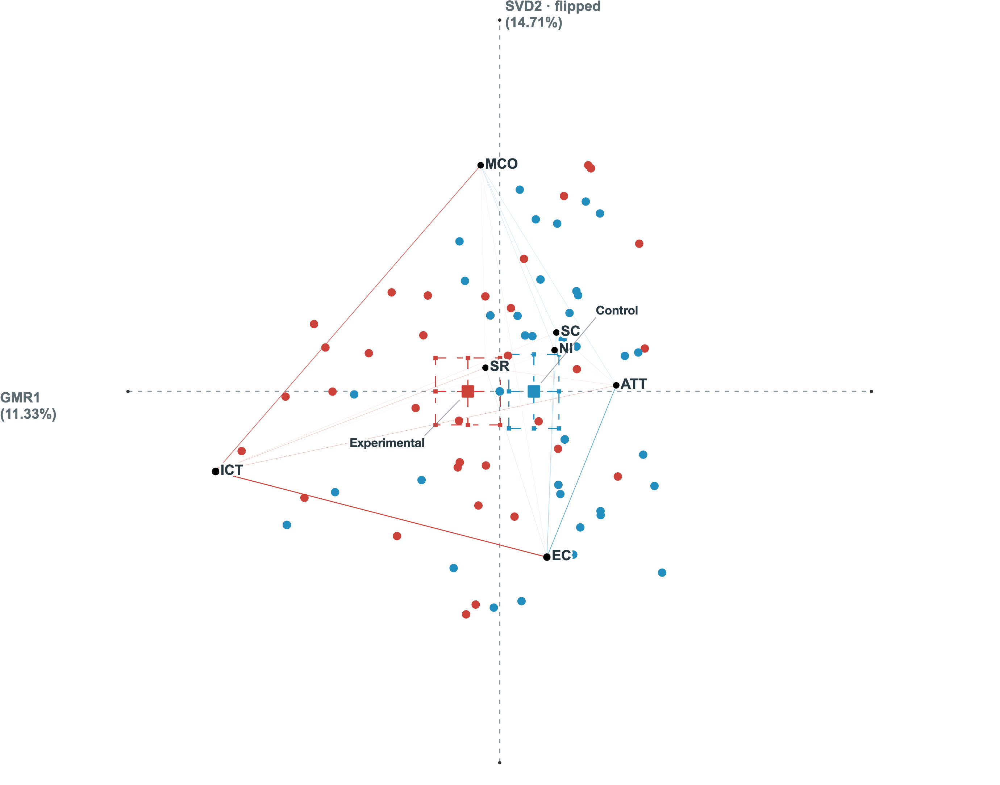

# 2D EndPoint parity evidence

This candidate addresses five failures in one 2D EndPoint workflow: rejection of individual zero networks, an unsuitable fresh two-group rotation default, missing or mismatched statistics, axis-sensitive point pre-scaling, and overlapping group labels.

## Implementation boundaries

- Retain individual zero-network observations in Standard EndPoint fits while keeping whole-population rank checks and trajectory admission checks.
- Default a fresh interactive EndPoint to Means only when two complete, Unit-stable typed groups are available. Preserve explicit, imported, and cloud-restored rotation choices.
- Add 2D point–centroid Pearson/Spearman diagnostics in source Unit order, Welch summaries using the official four-decimal coordinate input convention, and official-style minimum U / absolute effect-size cards. Raw model coordinates and native directional inference remain intact.
- Reconstruct original Unit/code order and replay the one-contrast R Means direction in an isolated browser worker. Compute the official display-only pre-scale and complete-axis camera extent without modifying jENA results. The pinned BLAS/LAPACK assets carry hashes, provenance and their license. The compatibility path has explicit resource and availability limits and does not assert universal GMR/Means equivalence.
- Derive short group names from typed metadata and place text around means, nodes, CIs and other labels. Preserve model identity and scientific mark positions.

The statistics/frame/label presentation paths are gated to 2D Standard EndPoint. Standard EndPoint admission and fresh model defaults are shared model-layer rules. There are no dedicated 3D, ONA, or jENA-core changes in this PR; this evidence does not claim new 3D/ONA browser acceptance.

## Input and A/B procedure

The owner-provided `Yu_ena_coded_data_0712.xlsx` was used without editing. Its SHA-256 is `22f01f2b2fbc95cc1316083af86a82364e9f64470fae4f9a86310342abfef6ee`; the parsed typed-cell SHA-256 is `1bebd33de14571e13c029ba6803f59906394b01ae1d1bdca41c78444fe2ad5ec`.

Sheet1 contains 174 rows. Units are Group + Name; Horizons are Group + Name + Lesson; codes are EC, ICT, MCO, NI, SR, SC, ATT. Both runs use Binary/Sphere, backward 1, forward 0 and confirmed source order. The population is 87 Units: 45 Experimental and 42 Control, including six zero-network Units.

- **A:** fresh browser workspace, upload the workbook, configure fields through the UI, retain the automatic Means default.
- **B:** separate fresh workspace, upload the same workbook, apply the explicit configuration and select Means.
- Run the actual parametric and nonparametric actions, inspect GoF and variance, then download each model, statistics JSON, SVG and PNG.
- Compare browser downloads to the captured official A/B exports and generated responses. Align only the permitted global axis directions (X +1, Y −1).

## Reviewable evidence

`summary.json` records the exact candidate and validation outcomes. `numeric-summary.json` aggregates all checks by category; `render-summary.json` covers actual SVG marks normalized by visible axis endpoints. `label-layout.json` records the six browser display scenarios for each case. `provenance.json` hashes the original local evidence files without publishing identity-bearing data.

The attached images are native 2D plot exports with unit identities omitted. The workbook, raw rows, full model exports, authentication state, local credential/runtime files and official account screenshots are retained locally and are not part of this PR.

| A: fresh default | B: explicit Means |
|---|---|
|  |  |

[Vector A](A.svg) · [Vector B](B.svg)

## Precision and reproducibility

Official outputs are rounded to four decimal places. Numeric comparisons use the corresponding ±0.000050001 interval; counts and minimum U are exact. SVG geometry uses the same transport-rounding bound divided by the visible axis extent. The official A automatic GMR and B explicit Means first two axes agree for this workbook; this is not a general identity claim.

The source test fixtures separately include 120 signed native-R oracle cases with row/code permutations and zero networks. Tests reject stale plans, altered WASM assets, inadmissible matrices and non-Means frame requests. Original scientific geometry is compared separately from the new label text and leaders.

An authorized reviewer with the original workbook and private official-evidence directory can run:

```sh
node --import tsx scripts/verify-open-ena-2d-parity.ts <workbook.xlsx> <official-evidence-directory> <output-directory> [browser-download-directory]
```

The optional browser directory must contain `A/model.json`, `A/statistics.json`, `B/model.json`, and `B/statistics.json`; bundle integrity and statistics bindings are checked before comparison. No private workbook is embedded in the application or its automated synthetic tests.

## No-deployment boundary

This PR is for review only. `vercel.json` disables automatic deployments for the exact branch `codex/ena-2d-parity`; other branches retain their existing behavior. See [Vercel's branch-specific Git configuration](https://vercel.com/docs/project-configuration/git-configuration). Do not merge or deploy without separate owner authorization.
